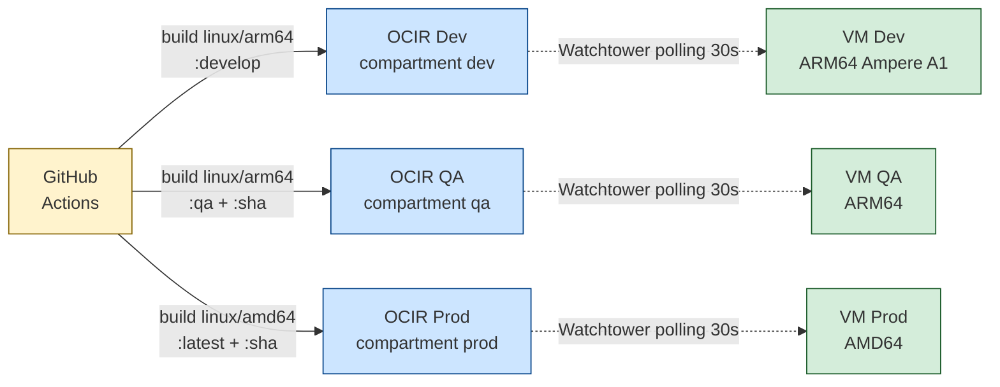

# Cloud Architecture

Skill de plataforma. Cubre dónde corre el sistema y cómo se desplega.
**El proyecto corre en Oracle Cloud Infrastructure (OCI), no en AWS.** El nombre
genérico (`cloud-architecture`) deja la skill aplicable si en el futuro se
agrega o migra a otro proveedor.

## Cuándo activar

- Decidir cómo deployar un servicio nuevo (compute, redes, secretos).
- Configurar VCN / subnets / NSGs (security lists).
- Setup de IAM, principio de menor privilegio en OCI.
- Diseñar observabilidad (logs, métricas, alertas, tracing).
- Estimación o reducción de costos.
- Estrategia de DR cross-region.
- Cambios en CI/CD (nuevo target, nueva platform, secrets nuevos).

**No activar** para issues operativos del día a día (mover un container,
reiniciar un servicio) — eso es runbook de Ops.

## Topología del deploy (verificada vs `Pipeline.md` y `.github/workflows/ci.yml`)



## Compute por ambiente

| Ambiente | Plataforma | Shape OCI | Razón |
| --- | --- | --- | --- |
| **Dev** | `linux/arm64` | Oracle Ampere A1 (Always Free tier) | Costo cero |
| **QA** | `linux/arm64` | Oracle Ampere A1 | Espejo dev para validar antes de prod |
| **Prod** | `linux/amd64` | Standard AMD64 | Decisión histórica (puede cambiarse a Ampere editando `PROD_PLATFORM` en `.github/workflows/ci.yml:28`) |

## OCIR — Oracle Cloud Registry

- **Region**: Phoenix (`phx.ocir.io`) — definido en secret `OCIR_REGISTRY`.
- **Topología**: un OCIR por compartment OCI (dev / qa / prod). Aislamiento
  por compartment significa que los secrets de un environment NO pueden leer
  los de otro.
- **Tags publicados**:
  - Dev: `:develop`
  - QA: `:qa` + `:<sha>`
  - Prod: `:latest` + `:<sha>`

Path completo de imagen:
`${OCIR_REGISTRY}/${OCIR_NAMESPACE}/${OCIR_REPO}:<tag>`

## Pipeline CI/CD (GitHub Actions)

> **Estado actual (verificado en `.github/workflows/ci.yml`)**: solo el Job 1
> (Build & Test) está activo. Los jobs Job 2 (push OCIR Dev) y Job 3 (push
> OCIR Prod) están **comentados**. Los emails de notificación están en el
> Job 1 activo.

| Evento | Build & Test | Push OCIR Dev | Push OCIR Prod |
| --- | --- | --- | --- |
| PR a develop / qa / main | sí | no | no |
| Push a qa | sí | no | no |
| Push a main | sí | no | sí (cuando se descomente) |
| `workflow_dispatch` en develop | sí | sí (cuando se descomente) | no |
| `workflow_dispatch` en main | sí | no | sí (cuando se descomente) |

> **TODO operativo**: descomentar los jobs `push-to-ocir-dev` y
> `push-to-ocir-prod` en `ci.yml` cuando los secrets OCIR estén listos por
> environment.

### Stack del pipeline

| Tool | Versión | Uso |
| --- | --- | --- |
| `actions/checkout` | v4 | Checkout |
| `actions/setup-java` | v4 | Java 21 Temurin con cache Maven |
| `docker/setup-qemu-action` | v3 | Emulación ARM64 (runners son x86) |
| `docker/setup-buildx-action` | v3 | Build multi-platform |
| `docker/build-push-action` | v6 | Build y push |
| `docker/login-action` | v3 | Auth OCIR |
| `aquasecurity/trivy-action` | master | Scan vulnerabilidades |
| `dawidd6/action-send-mail` | v3 | Notificaciones SMTP Gmail |

### Trivy (scan de vulnerabilidades)

- Se corre antes de cada push a OCIR.
- **Falla el pipeline** si hay vulnerabilidades `CRITICAL`.
- `ignore-unfixed: true` — no falla si no hay fix disponible.
- Reporte en `Actions → Artifacts → trivy-report-{dev,prod}`.
- Retención: 30 días.

## Watchtower (auto-deploy en VMs)

Cada VM corre Watchtower como container, polling el OCIR cada 30 segundos:

```bash
docker run -d \
  --name watchtower \
  --restart unless-stopped \
  -v /var/run/docker.sock:/var/run/docker.sock \
  -e REPO_USER="NAMESPACE/USUARIO_OCI" \
  -e REPO_PASS="AUTH_TOKEN" \
  containrrr/watchtower \
  --interval 30 \
  --cleanup \
  backend-perfumeria
```

Cuando el tag observado cambia (`:develop` en dev VM, `:qa` en qa VM,
`:latest` en prod VM), Watchtower descarga la imagen nueva, detiene el
container viejo, arranca el nuevo, y borra la imagen anterior (`--cleanup`).

> **Implicación**: el deploy es prácticamente continuo. No hay ventana de
> maintenance ni aprobación previa entre push y deploy. Los rollbacks
> requieren push de una imagen anterior con el tag esperado.

## Secrets — modelo por environment

GitHub Actions tiene **environments** dev / qa / prod. Cada environment tiene
sus propios secrets que NO se filtran a jobs de otros environments.

### Secrets por environment

> Definidos en `Pipeline.md` y consumidos en `ci.yml`. Verificados.

| Secret | Propósito |
| --- | --- |
| `ORACLE_URL`, `ORACLE_USER`, `ORACLE_PASSWORD` | Conexión a Oracle del environment |
| `LX_URL`, `LX_USER`, `LX_PASSWORD` | Conexión AS400 |
| `MAIL_USERNAME`, `MAIL_PASSWORD` | SMTP Gmail con App Password |
| `JWT_SECRET` | Clave JWT (≥32 chars) |
| `OCIR_REGISTRY` | `phx.ocir.io` |
| `OCIR_NAMESPACE` | Namespace del tenant OCI |
| `OCIR_REPO` | Nombre del repo OCIR |
| `OCIR_USERNAME` | Usuario OCI (email) |
| `OCIR_AUTH_TOKEN` | Auth token OCIR (NO password de la cuenta) |

### Repository secrets (globales)

| Secret | Propósito |
| --- | --- |
| `NOTIFY_EMAILS_DEV` | Lista CSV de emails para alertas dev/qa |
| `NOTIFY_EMAILS_PROD` | Lista CSV de emails para alertas prod |

### Reglas

- **Nunca** hardcodear secrets en `application.yml` ni en `.env` versionado.
  Todos los secrets se inyectan vía variables de entorno desde el environment
  de GitHub o desde el `.env` local de cada servicio (no commiteado).
- Usar **`OCIR_AUTH_TOKEN`**, no la password real de la cuenta OCI. El token
  se rota independiente.
- Rotar `JWT_SECRET` requiere coordinación: invalidar todas las sesiones
  activas. No es trivial — agendar.

## Networking

> **Pendiente**: la topología VCN/subnets/NSGs no está documentada en el repo.

Lo que sí es verificable:

- **CORS** se enforce en `gateway` (`config-repo/gateway.yml`). Lista de
  orígenes permitidos: IPs internas `10.220.1.*` + `localhost:*` para dev.
- **Conectividad on-prem ↔ cloud**: el servicio core-process accede a AS400
  vía `jt400` desde la VM OCI. Esto implica que existe alguna forma de
  conectividad (VPN site-to-site, FastConnect, o public IP del AS400 con
  whitelist). **No documentado dónde**.

## Áreas pendientes de validar con Ops

> No deducibles del repo. Cuando Ops responda, actualizar las secciones
> correspondientes y eliminar el item.

1. **Topología VCN**: cuántas subnets, públicas vs privadas, IPs de las VMs
   de dev/qa/prod, routing tables.
2. **Security lists / NSGs**: qué puertos están abiertos a qué CIDRs.
3. **Conectividad AS400**: ¿VPN site-to-site? ¿FastConnect? ¿Public IP con
   whitelist? Latencia esperada.
4. **Logs centralizados**: ¿se exportan los logs de los containers a OCI
   Logging, ELK, Loki, o solo viven en `docker logs` de cada VM?
5. **Métricas**: ¿OCI Monitoring activo? ¿Prometheus? Métricas críticas
   (CPU, memoria, request latency, error rate).
6. **Alertas**: ¿qué alertas están definidas y a quién pagan?
7. **Backup de filesystem y configuración**: backup de `/var/lib/docker/volumes`,
   backups de las VMs, política de retención.
8. **DR cross-region**: ¿hay réplica en otra región OCI? ¿procedimiento de
   failover documentado y probado?
9. **Costos**: presupuesto mensual por ambiente, tags de costo por servicio,
   apagado automático de QA off-hours.
10. **Identidad / IAM**: provider del equipo (OCI IDCS, Okta, Google
    Workspace), roles asignados.

## Decisiones a tomar (tracked en próximo sprint)

- Descomentar los jobs `push-to-ocir-dev` y `push-to-ocir-prod` en `ci.yml`
  cuando los secrets estén listos.
- Decidir si prod migra a Ampere ARM64 (cambiar `PROD_PLATFORM=linux/arm64`).
- Definir runbook escrito de "VM caída en prod" — quién responde, qué
  chequea primero.
- Política de rotación de `JWT_SECRET` y `OCIR_AUTH_TOKEN`.

## Anti-patterns

- Credenciales hardcodeadas en `application.yml` o `.env` versionado.
- `OCIR_USERNAME` con password real en lugar de auth token.
- Compartir secrets entre environments (dev secrets disponibles en prod o
  viceversa).
- Push directo a `main` sin pasar por `develop → qa → main`.
- Hacer un deploy manual a prod sin abrir PR ni notificar.
- Watchtower con `--interval` muy corto (<10s) — saturación inútil del OCIR.

## Skills relacionadas

- `system-architecture` — vista cross-servicio (qué se deploya).
- `oracle-architecture` — la otra mitad de la plataforma (datos).
- `docker-compose` — orquestación local y construcción de imágenes.
- `etl-patterns` — flujos que cruzan boundary AS400 (on-prem) ↔ cloud.
- `security-jwt` — autenticación que asume el modelo de red descrito acá.
- `git-conventions` — branch flow `develop → qa → main` que dispara el
  pipeline.
