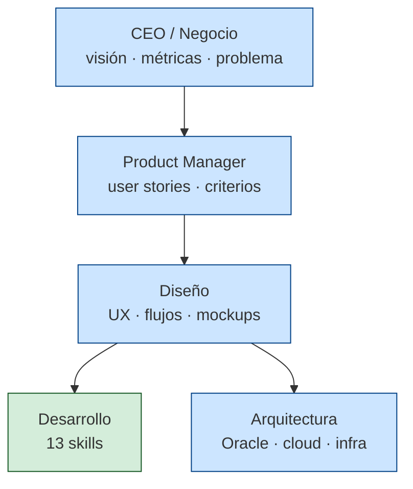

# Organigrama de Skills — Plataforma Fehub

Mapa de las skills de `.claude/skills/` a un organigrama empresarial.
Cada nivel representa una capa de responsabilidad: del problema de negocio
hasta la operación técnica.

## Estructura

Verde = poblado y validado contra código real. Azul = stub
(estructura definida, contenido específico del proyecto pendiente).

## Capa 1 — CEO / Negocio (stub)

[ceo-business](../../ceo-business/SKILL.md) — clarifica el _por qué_ antes de
saltar al _qué_ o al _cómo_. Activar para preguntas de oportunidad, OKRs,
trade-offs estratégicos, decisiones de dirección.

## Capa 2 — Product Manager (parcialmente activa)

| Skill | Activar cuando... |
| --- | --- |
| [user-experience](../../user-experience/SKILL.md) | Auditar el código existente para sacar requerimientos: deuda técnica, bugs latentes, features faltantes/incompletas y refactors. Output: backlog priorizado por categoría, listo para `ama` o `pm-product`. |
| [ama](../../ama/SKILL.md) | **Antes** de planificar. Entrevista PM↔CEO sistemática (7 áreas) para extraer requerimientos completos sin asumir nada. Output: doc estructurado con meta, impacto, alcance, métricas, plazos, riesgos. |
| [pm-product](../../pm-product/SKILL.md) (stub) | Después de AMA. Traduce las respuestas a user stories, acceptance criteria (Given/When/Then), scope de MVP y priorización. |

## Capa 3 — Diseño (stub)

[design-ux](../../design-ux/SKILL.md) — UX, flujos de usuario, wireframes,
principios de UI, accesibilidad. Aplica cuando se incorpore frontend al
ecosistema Fehub.

## Capa 4 — Desarrollo (13 skills activas)

### 4.1 Fundamentos

| Skill | Activar cuando... |
| --- | --- |
| [java-coding-standards](../../java-coding-standards/SKILL.md) | Escribís Java (naming, Optional, streams, immutability). |
| [java-docs](../../java-docs/SKILL.md) | Agregás Javadoc a tipos públicos. |
| [git-conventions](../../git-conventions/SKILL.md) | Commit, PR, branches main/develop/qa. |

### 4.2 Arquitectura del código

| Skill | Activar cuando... |
| --- | --- |
| [hexagonal-architecture](../../hexagonal-architecture/SKILL.md) | Definís puertos/adaptadores, domain vs infra. |
| [system-architecture](../../system-architecture/SKILL.md) | Vista cross-servicio: topología, datasources, gateway routing, flujo ETL, onboarding. |
| [api-design](../../api-design/SKILL.md) | Endpoints REST, DTOs, paginación, error responses. |
| [error-handling](../../error-handling/SKILL.md) | Excepciones de dominio, @ControllerAdvice. |

### 4.3 Datos

| Skill | Activar cuando... |
| --- | --- |
| [sql-oracle](../../sql-oracle/SKILL.md) | SQL Oracle: MERGE, native queries, procedures. |
| [database-migrations](../../database-migrations/SKILL.md) | Schema changes en Oracle/PostgreSQL. |
| [etl-patterns](../../etl-patterns/SKILL.md) | LX→Staging→Producción, AS400, jobs. |

### 4.4 Plataforma / Spring

| Skill | Activar cuando... |
| --- | --- |
| [java-springboot](../../java-springboot/SKILL.md) | Beans, profiles, DI, autoconfigure. |
| [security-jwt](../../security-jwt/SKILL.md) | JWT, refresh tokens, MFA, @PreAuthorize. |

### 4.5 Operación y calidad

| Skill | Activar cuando... |
| --- | --- |
| [docker-compose](../../docker-compose/SKILL.md) | Dockerfiles, compose.yml, env_file. |
| [testing-strategy](../../testing-strategy/SKILL.md) | Unit, @WebMvcTest, @DataJpaTest, integration. |

## Capa 5 — Arquitectura (stub)

Decisiones de plataforma que condicionan a todos los servicios.

| Skill | Activar cuando... |
| --- | --- |
| [oracle-architecture](../../oracle-architecture/SKILL.md) | Topología de instancias Oracle, RAC, Data Guard, partitioning, capacity, performance, backup. |
| [cloud-architecture](../../cloud-architecture/SKILL.md) | Plataforma cloud OCI: compute (ARM64 dev / AMD64 prod), OCIR, Watchtower, pipeline GitHub Actions, secrets por environment, networking, observabilidad. |

## Capa transversal — Analítica comercial

Análisis que cruzan datos de LX, las plataformas de las cadenas y la lista de un proveedor.
No pertenecen a un servicio: producen entregables para el cliente.

| Skill | Activar cuando... |
| --- | --- |
| [distribucion-cadenas](../../distribucion-cadenas/SKILL.md) | Un proveedor manda su lista de productos infaltables y hay que medir en qué sucursales de cada cadena está y dónde falta: fuentes, identidad de producto (EAN↔cod_feduro), mapeo cliente→sucursal, formato del Excel y trampas de datos. |

## Capa transversal — Herramientas del flujo

| Skill / herramienta | Activar cuando... |
| --- | --- |
| [owasp-audit](../../owasp-audit/SKILL.md) | Revisar seguridad, hardening, secretos expuestos, OWASP Top 10 (código, Docker, Terraform). |
| [commit](../../commit/SKILL.md) | `/commit` — Conventional Commits por grupo lógico, nunca en develop/main/qa, pregunta antes del push. |
| [tokens](../../tokens/SKILL.md) | `/tokens` — cuánto se gastó, qué se lo come y cómo aligerar la sesión. |
| graphify (externa, `graphify install`) | Mapa del código como grafo: `/graphify .` para crearlo, consultarlo antes de grepear. |
| ponytail (plugin `ponytail@ponytail`) | Siempre activo: reutilizar código existente / stdlib / nativo antes de escribir código nuevo. |
| agente `module-docs` | Contexto o actualización de la doc de un módulo en `.claude/docs/modules/`. |

## Cómo evoluciona este índice

1. Skill nueva → fila en la tabla del nivel correspondiente.
2. Skill obsoleta → ~~tachado~~ y mover a sección "Histórico".
3. Mantener el Mermaid sincronizado con las capas reales.
4. Cuando una skill sale de "stub" (azul) y queda poblada → cambiar a verde
   en el Mermaid y quitar el sufijo "(stub)" del título.
