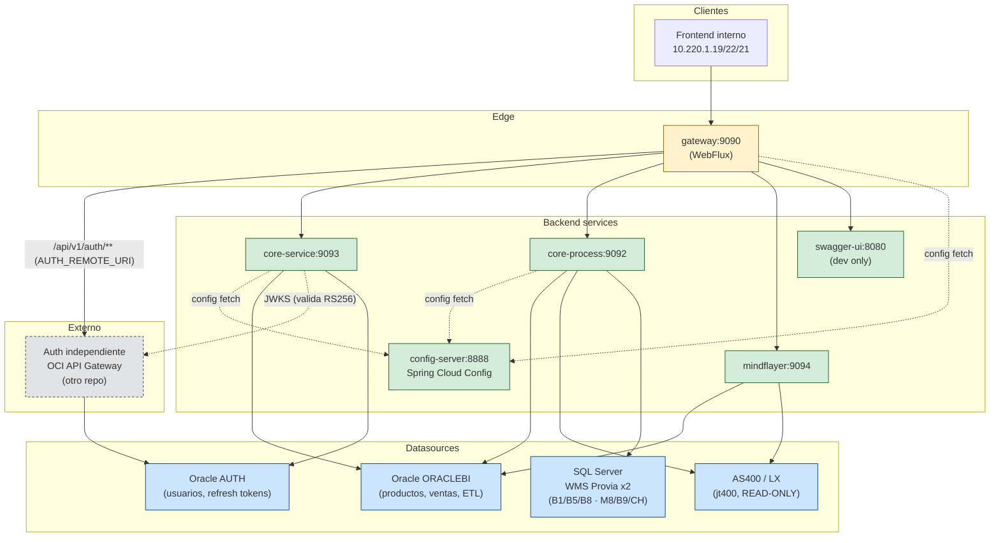
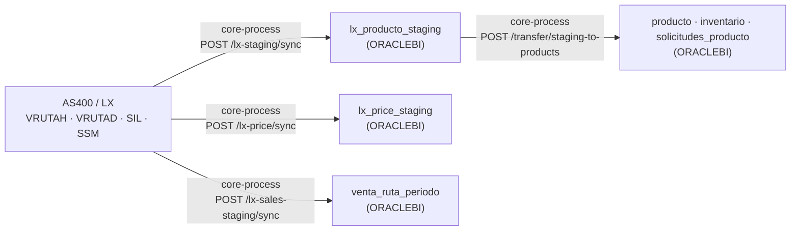

# System Architecture

Vista de pájaro de toda la plataforma Fehub. Esta skill responde "¿qué hay
y cómo se conecta?" — distinto de las otras de arquitectura que responden
"¿cómo se construye dentro de un servicio?".

## Cuándo activar

- Diseñás una feature que toca más de un servicio.
- Onboarding: alguien nuevo necesita entender el sistema en 10 minutos.
- Decidir en qué módulo va a vivir un endpoint o flujo nuevo.
- Diagnosticar un bug que cruza servicios (¿quién llamó a quién?).
- Auditar dependencias antes de un cambio de schema o ruptura de contrato.

**No activar** para problemas que viven dentro de un solo servicio
(arquitectura de código, queries, JWT, etc.).

## Topología



## Servicios y puertos

| Servicio | Puerto | Responsabilidad | Multi-módulo Maven |
| --- | --- | --- | --- |
| `config-server` | 8888 | Sirve configuración centralizada (`config-repo/`) | Sí |
| `gateway` | 9090 | Spring Cloud Gateway (WebFlux). Único entry point. CORS, security headers, routing. | Sí |
| `core-service` | 9093 | Productos, inventario, precios, reportes, notificaciones, jobs | Sí |
| `core-process` | 9092 | ETL: AS400/LX → Staging → Producción Oracle | Sí |
| `mindflayer` | 9094 | Vendedores, metas, coberturas, períodos. Levantado con `Dockerfile.mindflayer.dev`. | Sí |
| `swagger-ui` | 8080 | Container de Swagger UI agregado. Solo en dev. | — |

## Gateway routing (path → servicio)

Verificado contra `config-repo/gateway.yml`.

| Path | Servicio target |
| --- | --- |
| `/api/v1/auth/**` | Auth independiente (OCI API Gateway), vía `AUTH_REMOTE_URI` |
| `/api/v1/transfer/**`, `/api/v1/lx-staging/**`, `/api/v1/lx-price/**`, `/api/v1/lx-sales-staging/**` | core-process:9092 |
| `/api/v1/admin/data-protection/**`, `/api/v1/reports/sell-staging/**` | core-process:9092 |
| `/api/v1/products/**`, `/api/v1/master-catalog/**`, `/api/v1/admin/**`, `/api/v1/job-runs/**`, `/api/v1/notifications/**`, `/api/v1/reports/**`, `/api/v1/precios/**`, `/api/v1/catalog/**`, `/api/v1/servicedesk/**`, `/api/v1/companies/**` | core-service:9093 |
| `/api/v1/managers/**`, `/api/v1/sellers/**`, `/api/v1/targets/**`, `/api/v1/coverage/**`, `/api/v1/periods/**`, `/api/v1/sync/**` | mindflayer:9094 |
| `/docs/**`, `/<svc>/v3/api-docs/**` (dev) | swagger-ui:8080 + servicios |

> Nota: el route `/api/v1/notifications/**` sigue declarado en `gateway.yml` y
> apunta a core-service, pero el **dominio de notificaciones fue retirado** (no
> existe `NotificationController`). Es un route huérfano pendiente de limpieza.

## Datasources reales por servicio

Verificado contra archivos `*DataSourceConfig.java` y `config-repo/<svc>.yml`.

| Servicio | Datasource bean | Driver | Propósito |
| --- | --- | --- | --- |
| **core-service** | `oracleDataSource` (Primary) | OracleDriver | Schema ORACLEBI: productos, inventario, catálogo, notificaciones |
| **core-service** | `authDataSource` | OracleDriver | Cross-reads al schema AUTH (para reportes que cruzan usuarios + datos) |
| **core-process** | `oracleDataSource` (Primary) | OracleDriver | Schema ORACLEBI: producción ETL |
| **core-process** | `oracleReportsDataSource` | OracleDriver | Schema Reports (capitalizado, cuidado con `Reports` vs `ORACLEBI`) |
| **core-process** | `lxDataSource` | `com.ibm.as400.access.AS400JDBCDriver` | AS400/LX. **READ-ONLY absoluto** |
| **core-process** | `oracleSelloutDataSource` | OracleDriver | PDB `REPORTS`, schema SELLOUT (sell-in/bridge de ítems) |
| **core-process** | `providaDataSource` | `com.microsoft.sqlserver.jdbc.SQLServerDriver` | **WMS** Provia/Infor ViaWare — bodegas B1, B5, B8 |
| **core-process** | `providaM8DataSource` | `com.microsoft.sqlserver.jdbc.SQLServerDriver` | **WMS**, segunda instancia — bodegas M8, B9, CH |
| **mindflayer** | `oracle` (primary, gestiona Liquibase) | OracleDriver | Schema mindflayer (Reports/ReportStaging) |
| **mindflayer** | LX | AS400JDBCDriver | Lectura de VRUTAH/VRUTAD/SIL para gestión de metas |

Total real: **2 instancias Oracle** (AUTH + ORACLEBI con varios schemas, más la PDB `REPORTS`) +
**AS400/LX** + **SQL Server** = **4 motores de DB distintos**, pero **6 destinos** desde core-process,
porque el WMS son **dos instancias** SQL Server repartidas por bodega.

> **El WMS no es solo inventario.** Además del stock físico, es el dueño del **estado de picking del
> pedido** (`om_f.ob_ord_stt`, `od_f.ob_lno_stt`): los códigos de 4 letras tipo `RDY`/`CPNT`/`HOLD`
> que muestra el 108 son de ahí, **no de LX** — LX guarda un código de un solo carácter en
> `ECH.HSTAT`. La llave entre los dos es `om_f.ob_oid` = `ECH.HORD`. Ver
> `docs/sinap-pedidos-estados-wms.md`.

> Nota: `core-service/.../ReportsDbConfig.java` existe pero está vacío
> (`@Configuration` sin beans). Es un placeholder, no un datasource activo.

## Flujo ETL — AS400 → Producción



Schedule: `syncLxStagingDiario` cron `0 0 6 * * *` (06:00 AM diario);
notificaciones semanales `0 0 8 * * MON`.

## Dependencias entre servicios

**No hay llamadas HTTP servicio-a-servicio en runtime** (no se usa `RestClient`,
`WebClient` ni `RestTemplate` entre módulos). Toda llamada externa entra por
el gateway. Las únicas dependencias en arranque son:

- Todos los servicios → `config-server` (fetch de config al boot).
- `gateway` → `core-process` (declarado en `compose.yml` como `depends_on`
  para health checks).
- Única salida HTTP fuera del stack: el gateway rutea `/api/v1/auth/**` al auth
  independiente, y cada servicio servlet le pide el JWKS para validar RS256.

Acoplamiento bajo: cada servicio es deployable independientemente una vez
que `config-server` está arriba.

## Liquibase — solo mindflayer

Los 6 servicios principales gestionan schema **manualmente en Oracle**, salvo
mindflayer que usa Liquibase:

```
mindflayer/src/main/resources/changelog/db.changelog-master.yaml
mindflayer/src/main/resources/changelog/changes/*.yaml
```

Ver skill `database-migrations` para el detalle.

## Deploy y CI/CD

- **Plataforma**: Oracle Cloud Infrastructure (OCI), no AWS.
- **Compute**: ARM64 Ampere en dev, AMD64 en prod.
- **Orquestación**: Docker Compose (no Kubernetes).
- **Registry**: OCIR (Oracle Cloud Infrastructure Registry).
- **CD**: Watchtower observa el registry y actualiza containers automáticamente.
- **CI**: GitHub Actions (`.github/workflows/ci.yml`) — build + test en PRs a
  main/develop/qa. Pipeline de deploy (Trivy → push OCIR) está definido pero
  comentado.

Ver skills `docker-compose` y `cloud-architecture` para detalles.

## Inconsistencias documentales vs realidad (deuda)

> Estado a 2026-04-27. Alinear cuando se toque cada doc.

1. ~~CLAUDE.md dice "PostgreSQL (usuarios/auth)"~~ — **obsoleto (2026-09-17)**: el auth
   se fue a un servicio independiente y este repo ya no tiene módulo de auth. La
   instancia Oracle AUTH sigue existiendo, pero acá solo la lee `core-service`.
2. **CLAUDE.md** lista endpoints públicos pero NO menciona Swagger/`docs/**`,
   que es público vía gateway-dev.
3. **CLAUDE.md** describe 2 datasources (PostgreSQL + Oracle). Realidad:
   4 motores distintos (Oracle x N schemas + AS400 + SQL Server Provida).
4. **`AGENTS.md`** duplica info con CLAUDE.md sin política clara de fuente
   de verdad.
5. **`mindflayer`** queda fuera del `<modules>` raíz pero CLAUDE.md lo lista
   como módulo. Aclarar que es servicio satélite con su propio Dockerfile.

## Anti-patterns

- Llamar de un servicio a otro directamente por HTTP. Hoy nadie lo hace —
  mantenerlo así. Si hace falta, evaluar primero si la lógica debería vivir
  en el servicio target.
- Compartir datasources entre módulos del mismo proyecto. Cada servicio
  define los suyos.
- Asumir que todos los servicios usan Liquibase. Solo mindflayer.
- Agregar un endpoint nuevo sin actualizar la tabla de gateway routing.
- Documentar la realidad solo en CLAUDE.md sin actualizar este index. Esta
  skill debe quedar **sincronizada con el código** — si agregás un servicio,
  servicio nuevo va acá Y en INDEX.md.

## Skills relacionadas

- `hexagonal-architecture` — cómo se estructura un servicio individual.
- `oracle-architecture` — detalle de plataforma de las instancias Oracle.
- `cloud-architecture` — capa cloud (OCI: OCIR, Watchtower, CI/CD).
- `etl-patterns` — flujo LX → Staging → Producción detallado.
- `api-design` — contratos REST entre frontend y gateway.
- `security-jwt` — autenticación que cruza el gateway.
- `docker-compose` — orquestación local y deploy.
